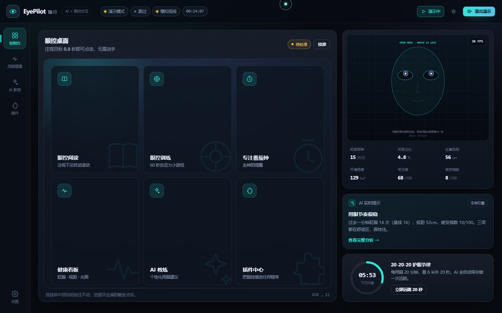
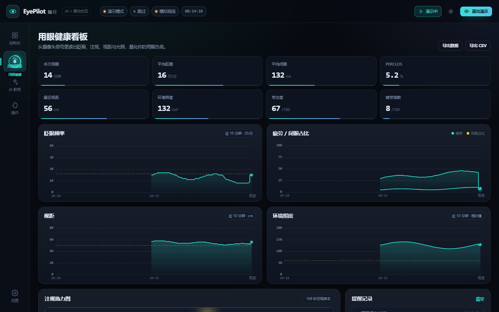
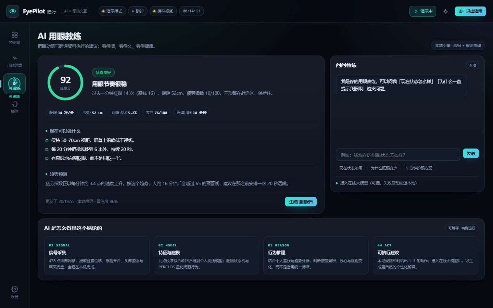
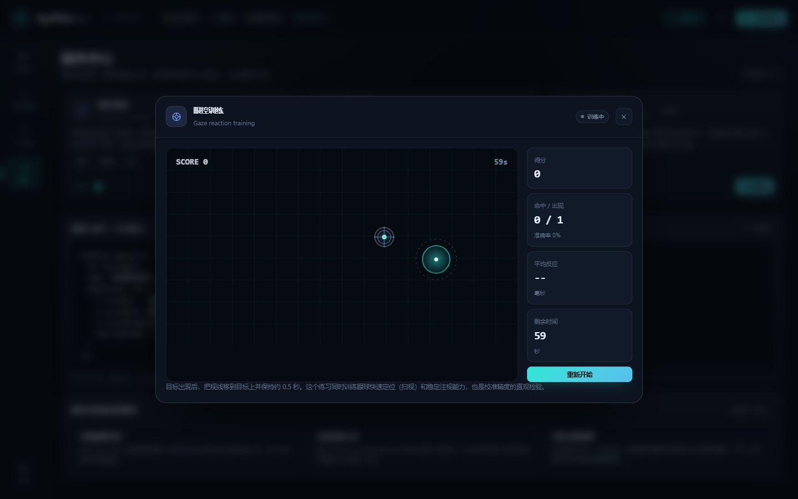

# EyePilot · 瞳行

**用一颗普通摄像头，让眼睛既成为鼠标，也成为被照顾的对象。**

AI 眼动交互 + 用眼健康监测的桌面 Web 应用。不需要 Tobii 之类的红外眼动仪，笔记本自带的摄像头就够；所有画面在本机浏览器里处理，不上传。

> 校园黑客松参赛作品 · 主题「AI + 眼动交互 / 视觉健康」
> **当前版本 v1.0.1** · [更新记录](CHANGELOG.md)

---

## 30 秒了解

| 能力 | 说明 |
| --- | --- |
| **眼控指针** | 478 点面部网格 → 虹膜相对位移 → 九点校准 → 视线映射到屏幕；注视 0.8 秒即点击，长眨眼也可触发 |
| **用眼健康** | 眨眼频率、平均闭眼时长、PERCLOS、估算视距、环境照度、专注度、疲劳指数，实时告警 + 20-20-20 远眺 |
| **AI 教练** | 个人基线学习 + 趋势外推，给出「现在该做什么」；可接入任意 OpenAI 兼容大模型，失败自动回退本地推理 |
| **插件系统** | 眼控阅读、眼控训练、眼控番茄钟三个内置插件；`EyePilot.register()` 十行接入新能力 |

没有摄像头也能演示：点右上角「演示」，用鼠标位置模拟视线，其余流程完全一致。

<p align="center">
  
  
</p>
<p align="center">
  
  
</p>

---

## 快速开始

### 两种形态，按场景选

| | 桌面版（推荐演示/提交） | 网页版（推荐发给别人） |
| --- | --- | --- |
| 打开方式 | 解压后双击 **`EyePilot.exe`** | 解压后双击 **`启动.bat`** |
| 界面 | 独立窗口，无地址栏、无标签页 | 默认浏览器窗口 |
| 体积 | 约 148 MB（自带 Chromium） | 约 21 MB（用系统浏览器） |
| 适合 | 答辩现场、自己电脑 | 微信/QQ 传给别人、快速体验 |

两个包都在 [Releases](https://github.com/Doreintie/Eyepilot/releases) 里：`EyePilot-Desktop-v1.0.1-win64.zip` / `EyePilot-Demo-v1.0.1-win64.zip`。

**网页版**自带官方 Python 便携运行时（`runtime/`），收件人不需要安装 Python；系统里已有 Python 也会自动复用。

### macOS / Linux / 手动

```bash
cd eyepilot
python serve.py            # 自动打开浏览器；加 --no-open 可关闭
```

要求 Python 3.9+。只用了标准库，无需安装任何依赖（Windows 包已内置运行时，macOS / Linux 用自己的 Python）。

> ⚠️ 必须通过 `http://localhost` / `127.0.0.1` 访问。直接双击 `index.html`（file:// 协议）浏览器不会授予摄像头权限。
> 推荐 Chrome / Edge 最新版。首次进入需允许摄像头，模型加载约 3–8 秒（本地缓存后更快）。

### 摄像头打不开？

| 现象 | 原因 | 处理 |
| --- | --- | --- |
| 「浏览器拒绝了摄像头权限」 | 之前点过「阻止」；或页面在预览窗口 / iframe 里 | 点地址栏最左侧的锁 / 相机图标 → 把「摄像头」改成**允许** → F5；预览窗口请把 `http://127.0.0.1:8848/` 复制到 Edge / Chrome 新标签页打开 |
| 「当前不是通过 localhost 打开」 | 用了 `file://` 或局域网 IP | 双击 `启动.bat` / 运行 `python serve.py`，用 `http://127.0.0.1:8848/` |
| 画面黑屏、没有报错 | 摄像头被会议软件占用 | 退出腾讯会议 / Zoom / OBS / 相机应用 |
| 有画面但检测不到人脸 | 逆光、脸太小、被遮挡 | 面对光源，让脸占画面 1/3 以上，摘掉遮挡眼睛的镜框反光 |
| 权限是允许但仍失败 | Windows 系统级相机开关关闭 | 设置 → 隐私和安全性 → 相机 → 打开「允许桌面应用访问相机」 |

### 首次使用流程

1. 点击右上角 **启动相机** → 允许摄像头。
2. 自动进入 **九点校准**：盯住出现的圆点，约 20 秒；结束会显示实测平均误差与视角误差。
3. 校准完成后把视线移到任意带 `data-gaze` 的按钮/磁贴上，光标进度环走满即点击。
4. 打开「用眼健康」看指标，「AI 教练」看建议；「插件」里体验眼控阅读 / 训练 / 番茄钟。

---

## 90 秒演示路径（答辩可直接照做）

1. **0:00** 打开控制台，说：「这是一颗普通摄像头，没有红外、没有额外硬件。」
2. **0:10** 启动相机 → 九点校准，强调「20 秒、9 个点、每次都需要重新校准是因为每个人的虹膜几何不同」。
3. **0:35** 视线依次停在三个磁贴上，让插件面板自己打开 —— 全程不碰鼠标。
4. **0:55** 打开「用眼健康」，指出眨眼频率曲线在下滑、视距在变小；点「立即远眺 20 秒」，让 AI 检测视线是否真的离开屏幕。
5. **1:15** 打开「AI 教练」：健康分、三条可执行建议、趋势预测，再点「生成用眼报告」下载 Markdown。
6. **1:30** 打开「插件」：三十秒眼控训练游戏，展示命中率与反应时；收尾讲插件 API 与隐私边界。

---

## 眼控手感（v1.0.1 重点）

眼控不是把鼠标坐标“模拟”出来，而是每一帧从虹膜关键点回归出屏幕位置——所以关键点有像素级噪声，直接输出就会抖。

v1.0.1 换了特征的坐标系：不再用「虹膜在眼框内的比例」（眼框高度只有 20px 左右，1px 抖动就是 5% 特征变化，而且上眼睑会跟着视线一起动），
而是用「虹膜相对内外眼角连线中点，以眼宽为单位」——眼角不随眨眼变化，垂直方向稳定得多。

| 问题 | 做法 |
| --- | --- |
| 光标抽搐 | 5 帧中值去跳点 + 一欧元滤波（截止频率下移）+ **2.2px 死区**（静止时微颤不输出）+ 低置信度时停在最后可信位置 |
| 整体偏上/偏下 | 校准末尾对每轴做**仿射拟合** `target ≈ a·pred + b`，同时修偏移与增益；还可「设置 → 视线微调 → 三点纵向校准」（中心/上/下各看 2 秒）专治“越往下越偏” |
| 整体偏左/偏右 | 8px 方向键微调，或直接重做校准（仿射校正会一并处理） |
| 误判离开屏幕 | 越界需持续 800ms 才判定，大幅越界（22% 屏外）才 220ms 快速判定；看屏幕最下沿不再误报 |
| 点不中 | 命中目标后光标逐渐吸到目标中心；眨眼和 180ms 内的短暂抖动不会重置注视进度 |
| 按钮太小 | **大按钮模式**默认开启，放大顶栏、侧栏、弹窗关闭、开关、输入框等所有可点目标；顶栏一键切换 |

对精度有更高要求时，设置里可以做 **16 点精细校准**（二阶特征，约 40 秒）。

### 校准坐姿与距离（直接影响误差）

| 项目 | 建议 | 原因 |
| --- | --- | --- |
| 脸到屏幕距离 | **50–65 cm**（约一臂） | 太近：虹膜在画面里过大、眼睑遮挡变多，垂直方向先饱和；太远：每像素对应的视角变大，同样 1px 抖动误差翻倍 |
| 脸在画面里的占比 | 宽度 **1/3 左右**（约 25–30% 画面宽） | 低于 20% 时关键点精度明显下降，校准会频繁采不到样本 |
| 眼睛高度 | 与屏幕上 1/3 齐平，略微俯视 | 这样看屏幕上下沿时虹膜位移是对称的，能减少“上准下偏” |
| 摄像头位置 | 尽量与屏幕中心同高，不要仰拍 | 仰拍会让眼睑遮挡加重，垂直特征被压缩 |
| 光线 | 光从正面来，避免背后亮窗 | 逆光时人眼变成剪影，关键点抖动成倍增加 |

校准页顶部会实时显示估算距离，并用「太近了 / 有点远」提示你调整。

---

## 技术架构

```
                     ┌──────────────────────────────────────────┐
  摄像头 960×720  ──▶ │ MediaPipe Face Landmarker (WASM/GPU)     │
                     │ 478 landmarks + 52 blendshapes           │
                     └───────────────┬──────────────────────────┘
                                     │ 每帧 ~10–20ms
                     ┌───────────────▼──────────────────────────┐
                     │ analyzeFace()  眼部几何特征               │
                     │ 虹膜/眼框比、头姿、IPD、眼睑开合、亮度      │
                     └───────┬───────────────────────┬──────────┘
                             │                       │
              ┌──────────────▼─────────┐   ┌─────────▼─────────────┐
              │ GazeTracker            │   │ HealthMonitor          │
              │ 岭回归映射 + 一欧元滤波  │   │ 眨眼状态机 / PERCLOS    │
              │ → 屏幕坐标 + 置信度      │   │ 视距 / 照度 / 专注 / 疲劳 │
              └──────────────┬─────────┘   └─────────┬─────────────┘
                             │                       │
                  ┌──────────▼─────────┐   ┌─────────▼─────────────┐
                  │ GazeInput          │   │ AICoach                │
                  │ 光标 / 注视点击 /   │   │ 本地规则+趋势预测       │
                  │ 长眨眼点击 / 防误触 │   │ 可选在线大模型          │
                  └──────────┬─────────┘   └─────────┬─────────────┘
                             └──────────┬────────────┘
                                        ▼
                          插件宿主 / 图表 / 报告 / 导出
```

### 视线是怎么算出来的

1. **特征**：每只眼睛取 16 个眼框点构成包围盒，虹膜中心相对眼框的位置记为
   `lx/ly/rx/ry`（统一为「鼻侧→颞侧」「上睑→下睑」，消除左右眼镜像差异）；再加头部偏航/俯仰。
2. **校准**：屏幕 3×3 共 9 个点，每个点收集约 1 秒有效帧，取**逐维中位数**抗眨眼抖动；
   得到 9 组「特征 → 屏幕坐标」样本。
3. **回归**：标准化后用**岭回归**（λ≈0.9，截距不惩罚）拟合，9 个样本即可训练，
   单帧预测 < 0.1ms，权重可解释。校准后额外用 5 个留出点验证，实测误差直接显示给用户。
4. **平滑**：屏幕坐标再过**一欧元滤波**（低通 + 速度自适应），默认强度 55，可在设置里调。
5. **置信度**：眼睛开合度、特征偏离校准分布的程度、头部偏航共同决定；置信度低时不点击。

### 用眼健康指标

| 指标 | 定义 | 参考阈值 |
| --- | --- | --- |
| 眨眼频率 | 60s 窗口内眨眼次数 | 15–20 次/分；< 8 触发提醒 |
| 平均闭眼时长 | 120s 内有效眨眼时长均值 | 100–150ms；> 220ms 视为疲劳信号 |
| PERCLOS | 60s 内眼睛闭合（open<0.38）时间占比 | < 15%；> 22% 强提醒 |
| 估算视距 | 针孔模型：`f·63mm / 虹膜像素距`，f 由水平视场 60° 估算 | 50–70cm；< 42cm 提醒 |
| 相对照度 | 摄像头画面平均亮度映射 | 非专业照度计，仅作相对比较 |
| 专注度 | 屏幕内注视比例 + 注视离散度 + 有效数据率 | 0–100 |
| 疲劳指数 | PERCLOS 34% + 眨眼频率 22% + 闭眼时长 10% + 连续时长 16% + 视距 10% + 离屏 8% | < 45 良好，≥ 65 预警 |
| 健康分 | `100 − 疲劳×0.85 − 眨眼不足惩罚` | > 75 良好 |

个人基线：眨眼频率与视距用指数滑动平均持续学习，AI 建议会引用「你的基线」而不是统一标准。

### AI 教练

- **本地推理（默认，离线可用）**：规则引擎 + 个人基线 + 疲劳趋势线性回归，
  输出「结论 / 2–3 句解释 / 最多 3 条可执行动作 / 趋势预测 / 置信度」。
- **在线大模型（可选）**：设置里填 OpenAI 兼容接口（base URL / model / key），
  把结构化指标发给模型，要求返回 JSON；超时或失败自动回退本地，不阻塞界面。
- AI 在三个地方出现：实时提示卡、教练页评估、对话问答；还能生成 Markdown 用眼报告。

---

## 插件 API

```js
EyePilot.register({
  id: 'my-plugin',
  name: '我的眼控插件',
  tagline: 'One-line description',
  icon: '<svg viewBox="0 0 24 24">…</svg>',
  description: '插件中心里显示的介绍',
  tags: ['演示', '无障碍'],

  mount(root, ctx) {
    root.innerHTML = '<h3>Hello, eyes!</h3>';
    ctx.onFrame((frame, gaze) => {
      // gaze: {x, y, nx, ny, valid, confidence, outside}
      // frame: {present, open, blinkL, blinkR, distanceCm, lightLux, yaw, pitch}
      if (gaze.valid) console.log(gaze.x, gaze.y);
    });
    ctx.onCleanup(() => { /* 清理定时器 / 监听 */ });
  },
  unmount(root, ctx) { /* 可选 */ },
});
```

`ctx` 还提供 `getMetrics()`、`getFrame()`、`settings`、`toast()`、`setStatus()`、`close()`。

不想写插件也可以只监听事件：

```js
window.addEventListener('eyepilot:click', (e) => {
  console.log('用户用眼睛点了', e.detail.target, e.detail.gaze);
});
```

详见 [`docs/插件开发指南.md`](docs/插件开发指南.md)。

---

## 目录结构

```
eyepilot/
├─ index.html                 单页应用：控制台 / 健康 / AI / 插件 / 设置
├─ styles/main.css            设计系统（暗色 + 亮色）
├─ src/
│  ├─ main.js                 启动、帧调度、模块编排
│  ├─ core/math.js            岭回归、一欧元滤波、趋势（纯函数，可单测）
│  ├─ core/health.js          健康指标公式（纯函数，可单测）
│  ├─ vision.js               MediaPipe 封装 + 眼部几何特征 + 骨架绘制
│  ├─ gaze.js                 视线跟踪 + 九点校准流程
│  ├─ input.js                眼控光标、注视点击、长眨眼点击
│  ├─ health-monitor.js       指标聚合、告警、20-20-20
│  ├─ ai.js                   本地 AI 教练 + 在线大模型 + 报告生成
│  ├─ plugins.js              插件注册与面板宿主
│  ├─ plugins/*.js            三个内置插件
│  ├─ charts.js               Canvas 折线图 / 热力图
│  ├─ demo.js                 演示模式（鼠标模拟视线 + 合成历史）
│  ├─ ui.js                   视图渲染与设置绑定
│  ├─ store.js                状态与本地持久化
│  └─ utils.js                DOM / 存储 / 提示音 / 下载
├─ vendor/mediapipe/          本地化的 MediaPipe 运行时与模型（约 22MB，可离线）
├─ runtime/                   Windows 便携 Python（官方 embed 包，免安装，不入 Git）
├─ desktop/                   Electron 桌面壳（main.cjs + 打包脚本）
├─ tools/test-core.mjs        25 个纯算法单测
├─ tools/gaze-bridge.py       外接程序信号桥
├─ serve.py                   零依赖静态服务器（修正 .wasm/.task MIME）
├─ 启动.bat                   Windows 一键启动（优先用内置运行时）
├─ 使用说明.txt               给收件人看的极简说明
├─ CHANGELOG.md               版本更新记录
└─ docs/                      提案书 / 演示脚本 / 插件开发指南 / 截图
```

---

## 发给别人 / 提交作品

两个打包产物体积超过 Git 仓库的常规范围，不随源码提交，放在 [Releases](https://github.com/Doreintie/Eyepilot/releases) 附件里。按对方情况选一个发：

**1. 桌面版 `EyePilot-Desktop-v1.0.1-win64.zip`（约 148 MB）**

- 解压后双击 `EyePilot.exe`，独立窗口运行，看不到浏览器地址栏。
- 摄像头权限由应用自己处理，不会弹浏览器的权限框。
- 体积大是因为 Electron 自带了一整套 Chromium；启动约 2–4 秒。
- Windows 10/11 直接可用；首次运行若被 SmartScreen 拦，点“更多信息 → 仍要运行”，
  或右键压缩包 → 属性 → 勾选“解除锁定”再解压。
- 微信若提示超过 100 MB，改用 QQ / 网盘发送，或发下面的网页版。

**2. 网页版 `EyePilot-Demo-v1.0.1-win64.zip`（约 21 MB）**

- 解压后双击 `启动.bat`，会自动打开默认浏览器。
- 自带 Python 运行时，无需安装、无需联网（模型已本地化）。
- 通过微信 / QQ 传输后，同样建议先“解除锁定”再解压。
- macOS / Linux 用户：`python3 serve.py`（需要 Python 3.9+），其余完全一致。

> 桌面壳源码在 `desktop/main.cjs`：内置一个只监听 127.0.0.1 的静态服务器，
> 自动授予摄像头权限，复用同一套网页资源。重新打包：`cd desktop && npm install && npm run dist`。

---

## 从源码运行

仓库不包含 `runtime/`（21MB 便携 Python）和打包产物，克隆后需要本机 Python 3.9+：

```bash
python serve.py
```

需要“解压即用”的免安装包，请到 [Releases](https://github.com/Doreintie/Eyepilot/releases) 下载 `EyePilot-Demo-v1.0.1-win64.zip`。

---

## 测试与验证

```bash
node tools/test-core.mjs
```

覆盖：岭回归恢复已知线性映射、特征维度、一欧元滤波收敛、中位数聚合、PERCLOS、
眨眼频率/时长、专注度、疲劳与健康分、视距与亮度估算、趋势回归、边界条件 —— **25 项全部通过**。

浏览器端已验证：

- 真实人脸图片 → MediaPipe 推理 → 478 点 / 52 blendshape → 眼部特征数值合理
  （`lx 0.58 / ly 0.43 / rx 0.54 / ry 0.46`，左右一致）
- 演示模式：视线跟随、注视点击、三个插件、图表、热力图、报告、导出、远眺流程、无控制台报错
- 虚拟摄像头：取流、模型加载、状态流转、校准覆盖层开关
- 用合成「完美用户」跑通九点校准 → 回归 → 验证 → 保存模型 → 预测，误差 7px / 0.17°
- 合成噪声（±1% 虹膜位移）下静止注视：光标抖动标准差 **2.9px（X）/ 1.3px（Y）**
- 注入 -5% 屏幕宽度的系统性偏差，校准后被正确扣除；手动 -80px 偏移同样按预期生效
- 16 点精细校准：16/16 点采集成功，二阶模型误差 7px

> 真实摄像头精度取决于光照、坐姿与摄像头素质，校准完成页会显示本次实测误差，通常在 1–3°。

---

## 隐私

- 视频帧只在浏览器内交给本地 WASM/GPU 模型，**没有任何一帧离开设备**。
- 只有匿名数值指标写入 `localStorage`（校准模型、个人基线、趋势序列），
  可在设置里一键清除。
- 若启用在线大模型，发送的是**纯数值指标 JSON**，不包含图像、不带身份信息。

---

## 已知限制

- 单目摄像头无深度，视距是几何估算，不是测距仪；强烈建议按「相对变化」理解。
- 大幅度转头、遮挡、逆光会降低精度；此时光标会降置信度并暂停点击，而不是乱跳。
- 环境照度用画面平均亮度映射，受摄像头自动曝光影响，标注为「相对值」。
- 疲劳指数是行为学估算，不构成医疗诊断。
- 当前为浏览器 Demo，眼控只在应用内生效；桌面级接管见路线图。

## 路线图

- **桌面级眼控层**：Electron 透明置顶层，把 gaze/click 映射到任意桌面应用。
- **无障碍输入桥**：WebSocket 把注视点与点击事件推给外部程序，服务运动障碍用户。
- **团队用眼健康**：匿名聚合看板 + 休息排班建议。
- **更稳的模型**：加入头部姿态补偿与多用户校准模板，降低重复校准成本。

## 提交材料

- [`docs/提案书.md`](docs/提案书.md) — 问题、方案、技术、创新点、可行性与商业化
- [`docs/演示脚本.md`](docs/演示脚本.md) — 3 分钟答辩脚本 + 评委问答 + 提交前检查清单
- [`docs/插件开发指南.md`](docs/插件开发指南.md) — API 与外部程序接入方式
